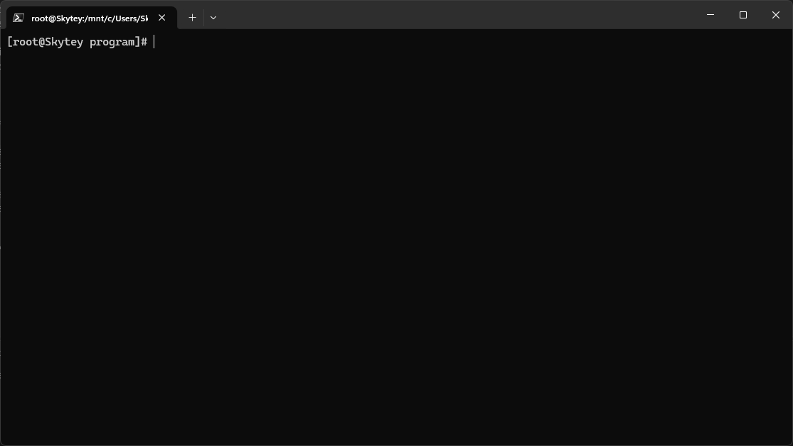

# some

[](https://kernel.org/)
[](https://en.wikipedia.org/wiki/X86-64)
[](https://www.nasm.us/)
[](https://en.wikipedia.org/wiki/C_(programming_language))

There's `more`, there's `less`, and now there's **`some`**: a `less`-style text viewer written by hand in x86-64 Linux assembly.



`some` prints a text file with line numbers. With `-p` it switches to a paged view you can move through in both directions, with a status bar showing the file path, page position and current time.

It was written as an assignment for the Systems and OS course at FIIT STU (2025). I sketched the logic in C first, then rewrote it in NASM assembly as a separately linked library.

## Features

- **Line numbers** on every line of the input
- **Paged mode** (`-p`): fills the terminal, then waits for a command
- **Paging in both directions**: next and previous page
- **Status bar** with the current page, total pages and percentage of the file shown
- **Current date and time** shown while paging
- **Absolute file path** shown while paging, shortened in the middle when it doesn't fit on one line
- **Files over 64 kB** are handled correctly (pages are precomputed as file offsets, not loaded at once)
- **Separately compiled library**: the viewer is an external `some` procedure, linked into a small driver program

## Usage

```
some [-h] [-p] <filepath>
```

| Option   | Effect                                                |
| -------- | ----------------------------------------------------- |
| *(none)* | Print the whole file with line numbers, like `cat -n` |
| `-p`     | Paged view                                            |
| `-h`     | Print usage help                                      |

In paged mode, type a command and press <kbd>Enter</kbd>:

| Key          | Action        |
| ------------ | ------------- |
| <kbd>n</kbd> | Next page     |
| <kbd>p</kbd> | Previous page |
| <kbd>q</kbd> | Quit          |

## Building

Requires Linux on x86-64, [NASM](https://www.nasm.us/), GCC and Make.

```bash
cd program
make
./bin/app -p ../README.md
```

or build and open a file in paged mode in one step:

```bash
make run ARGS=../README.md
```

The C prototype builds the same way from `prototype/`.

## How it's built

```
program/            the real thing
  src/some.asm      the viewer, exported as the `some` procedure
  src/app.asm       driver: strips argv[0] and calls `some`
prototype/          the C sketch the assembly was written from
  src/some.c
  src/app.c
  include/some/some.h
media/              showcase GIF
```

The assembly calls into libc (`printf`, `fgets`, `realpath`, `ioctl`, `localtime`, ...) and follows the System V AMD64 calling convention. Before paging starts, `some` reads the terminal size with `ioctl(TIOCGWINSZ)` and walks the file once to build a table of pages, storing each page's starting line number, length and file offset. Moving between pages is then just a `fseek` to the stored offset.

## Assignment

Base task (assignment 1, variant 6): print every input line prefixed with its line number. The optional extras below were all implemented:

| #   | Extra                                                                                   | Points |
| --- | --------------------------------------------------------------------------------------- | :----: |
| 1   | `-p` switch pages the output, waiting for a key after each full screen                  |   +1   |
| 2   | Paging works in both directions                                                         |   +2   |
| 3   | Show current page, total pages and percentage of output displayed                       |   +2   |
| 4   | Show the current date and time while paging                                             |   +1   |
| 5   | Show the absolute path of the input file, shortened in the middle if longer than a line |   +1   |
| 7   | Correctly handle input files over 64 kB                                                 |   +1   |
| 10  | Implemented as an external procedure, compiled separately and linked into the program   |   +2   |

## Known limitations

This was a course assignment and is kept as submitted, so it has rough edges:

- **Put flags before the path.** `some -p file` works, but `some file -p` crashes: `some_parse_args` doesn't preserve the flag pointers across the `realpath` call.
- **<kbd>Ctrl</kbd>+<kbd>D</kbd> in paged mode** loops forever instead of quitting, because `EOF` isn't handled as a command.
- **ASCII only.** Control characters, non-ASCII text and lines that wrap in the terminal throw off the padding.
- **Paths are limited to 256 bytes**, and allocation failures aren't checked.
- Commands need <kbd>Enter</kbd>, and the screen is redrawn with `system("clear")`, since the terminal isn't put into raw mode the way `less` does it.
